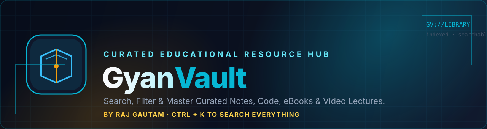
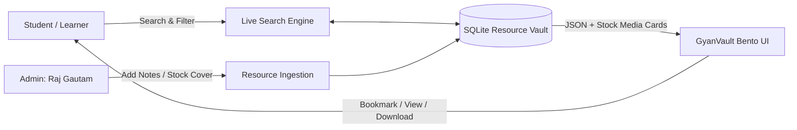
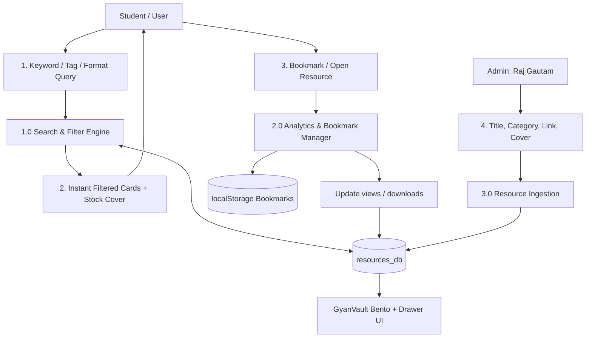

<div align="center">

[](https://github.com/Rg100152/GyanVault)

[](https://github.com/Rg100152/GyanVault)

[](https://github.com/Rg100152)
[](https://www.python.org/)
[](https://flask.palletsprojects.com/)
[](https://www.sqlite.org/)
[](LICENSE)

[](https://github.com/Rg100152/GyanVault/stargazers)
[](https://github.com/Rg100152/GyanVault/network/members)
[](https://github.com/Rg100152/GyanVault/issues)
[](https://github.com/Rg100152/GyanVault/commits/main)

**Search, Filter & Master Curated Notes, Code, eBooks & Video Lectures.**

[Explore the library](https://github.com/Rg100152/GyanVault) · [Report a bug](https://github.com/Rg100152/GyanVault/issues) · [Star the repo](https://github.com/Rg100152/GyanVault)

</div>

---

## What is GyanVault?

**GyanVault** is a full-stack, searchable educational content library built with **Flask + SQLite + Vanilla JavaScript**. It keeps study resources — notes, code repos, cheat sheets, eBooks and video courses — in one fast, beautifully organised vault.

No login. No reload. Just press <kbd>Ctrl</kbd> + <kbd>K</kbd> and start typing.

> **Curated by Raj Gautam** — every resource is picked for clarity, authority and actual learning value.

---

## Features

| Feature | What it does |
| --- | --- |
| ⌘ **Command Search (`Ctrl + K`)** | Raycast-style palette with arrow-key navigation and instant results. |
| ⚡ **Instant Filtering** | Keyword, subject, format and difficulty filters apply without a page reload. |
| 🖼️ **Rich Media Cards** | Unsplash covers, format badges, difficulty, view & download counters. |
| 🪟 **Slide-Over Preview** | Glass drawer with full summary, tags, curator credit and direct link. |
| 🔖 **Personal Bookmark Vault** | One-click saves in `localStorage`, with a dedicated `/saved` view. |
| 📊 **Live Bento Dashboard** | Total resources, subjects, views and downloads at a glance. |
| ✍️ **Admin Publisher (`/add`)** | Clean form for Raj Gautam to index a new resource in seconds. |
| 🔌 **JSON API** | `/api/resources`, `/api/stats`, counters and publishing endpoints. |

---

## System Architecture & Data Flow Diagrams

### DFD Level 0 — Context Diagram



### DFD Level 1 — Detailed Functional Flow



### DFD Level 1 — ASCII version

```text
[Student / User]
      │
      ├──(1. Search Keyword / Tag / Format)──► (1.0 Search & Filter Engine) ──► [SQLite: resources_db]
      │                                                   │
      │◄──(2. Instant Filtered Cards + Stock Cover)───────┘
      │
      ├──(3. Bookmark / Download Resource)───► (2.0 Analytics & Bookmark Mgr) ──► [Update Download Count]
      │
[Admin: Raj Gautam]
      │
      └──(4. Submit Title, Category, Link, Stock Image)──► (3.0 Resource Ingestion) ──► [SQLite: resources_db]
```

---

## UI Design Language

**Cyber-Slate Editorial + Command Search** — inspired by Linear and Raycast.

| Token | Value | Use |
| --- | --- | --- |
| Background | `#0B1120` | Deep slate canvas |
| Glass card | `#131C31` | Cards, drawer, navbar |
| Cyan | `#06B6D4` | Primary accent, focus, active states |
| Amber | `#F59E0B` | Secondary accent, difficulty, curator credit |
| Text | `#E6EDF7` / `#93A4BC` | Primary / muted |

1. **Command-Bar Hero** — bold heading, glowing smart search, quick format chips.
2. **Rich Media Grid** — responsive bento cards with stock covers and format badges.
3. **Slide-Over Drawer** — right-side glass panel, opens in 420 ms, closes on backdrop or <kbd>Esc</kbd>.
4. **Command Palette** — <kbd>Ctrl</kbd>+<kbd>K</kbd>, <kbd>↑</kbd>/<kbd>↓</kbd>, <kbd>↵</kbd>, <kbd>Esc</kbd>.

---

## Quick Setup (Linux / Pop!_OS)

```bash
git clone https://github.com/Rg100152/GyanVault.git
cd GyanVault

python3 -m venv venv
source venv/bin/activate

pip install -r requirements.txt
python seed_library.py
python app.py
```

Open **http://127.0.0.1:5000** and press <kbd>Ctrl</kbd> + <kbd>K</kbd>.

To rebuild the seed data from scratch:

```bash
python seed_library.py --reset
```

---

## Project Structure

```text
GyanVault/
├── app.py                      # Flask app factory, blueprints, error handlers
├── seed_library.py             # 20 curated resources + 10 categories, Unsplash covers
├── requirements.txt            # Flask dependency
├── README.md                   # This file
├── .gitignore                  # Ignores venv, __pycache__, *.db
├── database/
│   ├── __init__.py             # SQLite connection + schema helpers
│   └── gyanvault.db            # Generated: resources, categories, bookmarks
├── routes/
│   ├── __init__.py
│   ├── library_routes.py       # Home, saved vault, admin publisher
│   └── api_routes.py           # Live JSON search, filters, counters, publish
├── templates/
│   ├── base.html               # Glass navbar, drawer, command palette, footer
│   ├── index.html              # Hero, chips, bento stats, resource grid
│   ├── add_resource.html       # Admin form for Raj Gautam
│   └── 404.html                # Branded error page
└── static/
    ├── css/
    │   └── gyanvault.css       # Deep slate theme + slide-over + palette CSS
    ├── js/
    │   ├── searchEngine.js     # Instant search, filters, Ctrl+K palette
    │   └── drawer.js           # Slide-over preview, counters, bookmarks
    └── assets/
        ├── logo-gyanvault.svg  # Glowing teal vault + open book
        └── banner-gyanvault.svg
```

---

## API Reference

| Method | Endpoint | Description |
| --- | --- | --- |
| `GET` | `/api/resources` | List/filter resources via `q`, `category`, `format`, `difficulty`, `sort`, `limit` |
| `GET` | `/api/resources/<id>` | Fetch one resource |
| `GET` | `/api/stats` | Totals: resources, categories, views, downloads |
| `GET` | `/api/categories` | All categories |
| `POST` | `/api/resources` | Publish a new resource (JSON or form data) |
| `POST` | `/api/resources/<id>/view` | Increment view counter |
| `POST` | `/api/resources/<id>/download` | Increment download counter |

Example:

```bash
curl "http://127.0.0.1:5000/api/resources?q=python&format=PDF%20Notes"
curl -X POST http://127.0.0.1:5000/api/resources/1/view
```

---

## Seed Library

20 resources across 10 subjects — Python, Cyber Security, Linux, Web Development, Data Structures, Mathematics, Data Science & AI, Databases, DevOps and Competitive Programming. Every cover is a direct, key-free Unsplash delivery URL.

<details>
<summary><b>Show the catalogue</b></summary>

| # | Resource | Category | Format |
| --- | --- | --- | --- |
| 1 | Python Crash Course — Complete Beginner Notes | Python | PDF Notes |
| 2 | Python Roadmap 2026 — From Zero to Deploy | Python | GitHub Repo |
| 3 | Python Data Science Handbook | Data Science & AI | Free eBook |
| 4 | OWASP Top 10 — Web Security Field Guide | Cyber Security | Cheat Sheet |
| 5 | Ethical Hacking Lab Setup Notes | Cyber Security | PDF Notes |
| 6 | Linux Command Line Mastery — 120 Commands | Linux | Cheat Sheet |
| 7 | Linux Journey — Free Interactive Course | Linux | Video Course |
| 8 | MDN Web Docs — HTML & CSS Deep Dive | Web Development | Free eBook |
| 9 | React Patterns & Hooks Cheat Sheet | Web Development | Cheat Sheet |
| 10 | Data Structures Visualised — Big-O Poster | Data Structures | PDF Notes |
| 11 | GeeksforGeeks DSA — Interview Compendium | Data Structures | GitHub Repo |
| 12 | Linear Algebra for Machine Learning | Mathematics | PDF Notes |
| 13 | Discrete Mathematics — Logic & Proofs | Mathematics | Video Course |
| 14 | Kaggle Learn — 5 Free Micro-Courses | Data Science & AI | Video Course |
| 15 | scikit-learn Algorithm Cheat Sheet | Data Science & AI | Cheat Sheet |
| 16 | PostgreSQL Documentation | Databases | Free eBook |
| 17 | SQLBolt — Interactive SQL Lessons | Databases | Video Course |
| 18 | Docker in 30 Minutes — Hands-On Notes | DevOps | PDF Notes |
| 19 | Git & GitHub Survival Guide | DevOps | Cheat Sheet |
| 20 | Competitive Programming Starter Kit | Competitive Programming | GitHub Repo |

</details>

---

## Roadmap

- [x] Flask + SQLite core
- [x] Command palette & instant filtering
- [x] Slide-over preview with live counters
- [x] LocalStorage bookmark vault
- [x] Advanced GitHub README with DFDs
- [ ] Full-text SQLite FTS5 index
- [ ] CSV / JSON vault export
- [ ] Login + admin dashboard with charts
- [ ] Public submission review queue

---

## Contributing

Contributions are welcome. Fork the repo, create a branch, and open a pull request with a short description of the resource or improvement you added.

```bash
git checkout -b feat/my-improvement
git commit -m "feat: add my improvement"
git push origin feat/my-improvement
```

---

<div align="center">

### Crafted with precision by **Raj Gautam**

[](https://github.com/Rg100152)

**[⭐ Star GyanVault](https://github.com/Rg100152/GyanVault) · [🐛 Report an issue](https://github.com/Rg100152/GyanVault/issues)**

*GyanVault — indexed, searchable, free.*

</div>
